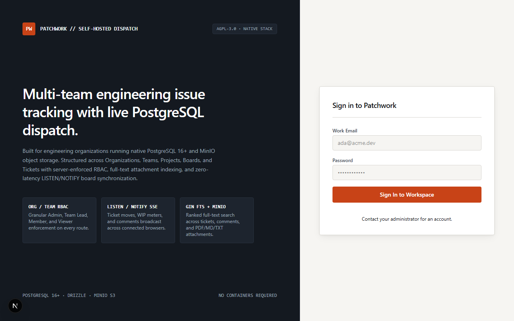

import { Tabs, TabItem, Aside } from "@astrojs/starlight/components";

This guide is for administrators and developers who want a working Patchwork instance in a few minutes.

## Prerequisites

- **Node.js 20+** (Node.js 22 LTS recommended)
- **PostgreSQL 16+** running locally on port `5432`
- **Official MinIO binary** placed in `./bin/`
- **Available ports**: `3000` (Next.js app) and `9000` (MinIO S3 API)

## Step 1: Download MinIO & Install Dependencies

<Tabs>
  <TabItem label="Windows (PowerShell)">
    ```powershell
    New-Item -ItemType Directory -Force -Path .\bin
    Invoke-WebRequest -Uri "https://dl.min.io/server/minio/release/windows-amd64/minio.exe" -OutFile .\bin\minio.exe
    npm ci
    ```
  </TabItem>
  <TabItem label="Linux (bash)">
    ```bash
    mkdir -p ./bin
    curl -fsSL "https://dl.min.io/server/minio/release/linux-amd64/minio" -o ./bin/minio
    chmod +x ./bin/minio
    npm ci
    ```
  </TabItem>
</Tabs>

## Step 2: Run the Native Installer

```bash
npm run setup
```

The installer verifies PostgreSQL and MinIO, writes `.env` with restricted permissions, runs Drizzle SQL migrations, prints your one-time **Admin Setup Token**, and starts the server.

<Aside type="caution">
Save the Admin Setup Token immediately. It is displayed once and cannot be recovered. If lost before completing `/setup`, you must run Reset in the installer.
</Aside>

## Step 3: Complete First Login

1. Open `http://localhost:3000/setup` in your browser.
2. Enter the Admin Setup Token to unlock the Setup Wizard.
3. Follow [Setup Wizard](/getting-started/setup-wizard/) to create your admin account, organization, teams, and boards.
4. Once locked, sign in at `http://localhost:3000/`.



## Expected Result

Patchwork serves the login screen at `http://localhost:3000/`, health checks return `200 OK` at `/api/health`, and you can sign in and view your Kanban board.

## Troubleshooting

- **`psql` not found on Windows**: Add `C:\Program Files\PostgreSQL\<version>\bin` to your user `PATH`.
- **Port `3000` or `9000` already in use**: Stop conflicting services or change `PORT` in `.env`. See [Troubleshooting & FAQ](/operations/troubleshooting/).

## Related Pages

- [Installation](/getting-started/installation/)
- [Setup Wizard](/getting-started/setup-wizard/)
