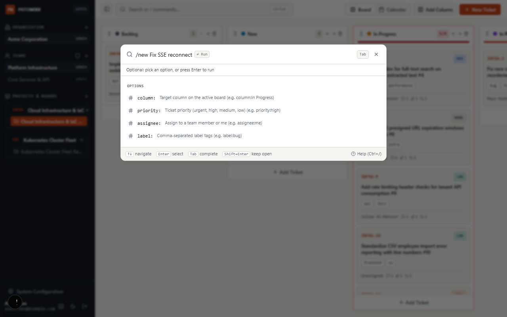

import { Aside } from "@astrojs/starlight/components";

This guide is for all workspace users (`admin`, `lead`, `member`, `viewer`).

<Aside type="note">
**Role note**: Commands shown in the Command Bar are filtered by your effective role. Authorization is also enforced server-side on `/api/commands/execute`.
</Aside>

## Opening & Navigating

- Press `Ctrl+K` (Windows/Linux) or `Cmd+K` (macOS) to open the Command Bar.
- Press `/` at the start of the input to enter **Slash Command** mode.
- Press `Ctrl+/` (`Cmd+/`) or run `/help` to open the categorized Command Reference.

## Inline Ghost Hints & Option Completion

- **Required and optional hints**: After typing a command and a space (e.g., `/move `), Patchwork renders inline ghost hints after the caret.
- **`/new` unquoted titles**: Type `/new Fix SSE reconnect` directly without quotes. Quotes are only needed if the title literally contains a `key:` token.
- **Option keys**: Once required arguments are filled, Patchwork lists remaining `key:` options (`column:`, `priority:`, `assignee:`, `label:`). Press `Tab`, `Enter`, or click a row to insert `key:` and open value suggestions.
- **Backspace rewind**: Pressing `Backspace` on an empty argument removes the previous token as a whole (including `key:value` options) and restores its hint.

## Execution, `Shift+Enter`, Undo & History

- **`Enter`**: Runs the command when ready and closes the bar.
- **`Shift+Enter`**: Runs the command and keeps the bar open for rapid batch entry.
- **Post-command snackbar**: Shows a 5-second notification (`aria-live="polite"`) with **Open** (for created/targeted tickets) and **Undo** (for undoable commands such as `/move`, `/assign`, `/priority`, `/label`, `/due`, `/rename`).
- **Destructive confirmation**: `/delete` and `/archive` display ticket context (title, column, assignee) with **Cancel** focused by default; press `Ctrl+Enter` (`Cmd+Enter`) to confirm.
- **Session history**: On a bare `/`, `ArrowUp` and `ArrowDown` recall safe commands from the current session (destructive commands and `/comment` are excluded; history clears on logout).

## Full Command Reference

See [Command Palette & Shortcuts Reference](/reference/command-palette/) for every command, usage format, argument, option, and role requirement.

You can also open the built-in documentation directly from the palette by running `/docs` (with an optional topic such as `/docs command-palette` or `/docs troubleshooting`) or by searching `documentation` in normal search mode.
