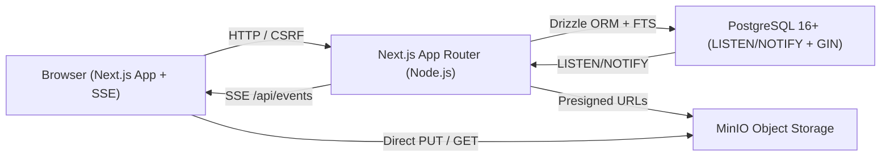

{{GENERATED_NOTICE}}

<div align="center">

<picture>
  <source media="(prefers-color-scheme: dark)" srcset="docs/assets/readme/logo-dark.svg" />
  <source media="(prefers-color-scheme: light)" srcset="docs/assets/readme/logo-light.svg" />
  
</picture>

**Keyboard-first, self-hosted engineering ticketing.**

Self-hosted ticketing for engineering orgs with teams, projects, and Kanban boards — no Docker required.

{{BADGES}}

{{QUICK_LINKS}}

<br />

<picture>
  <source media="(prefers-color-scheme: dark)" srcset="docs/assets/readme/hero-board-dark.webp" />
  <source media="(prefers-color-scheme: light)" srcset="docs/assets/readme/hero-board-light.webp" />
  
</picture>

</div>

<details>
<summary><strong>More screenshots</strong> (Ticket panel, Command bar, Search, System Configuration, Dark mode)</summary>

| Ticket Panel | Command Bar & Slash Commands |
| :---: | :---: |
|  |  |

| Full-Text Search | System Configuration (Dark Mode) |
| :---: | :---: |
|  |  |

</details>

---

## Table of Contents

- [Why Patchwork](#why-patchwork)
- [Features](#features)
- [Quick Start](#quick-start)
- [Documentation](#documentation)
- [Architecture & Tech Stack](#architecture--tech-stack)
- [Project Structure](#project-structure)
- [Development](#development)
- [Status & Roadmap](#status--roadmap)
- [Contributing, Security & License](#contributing-security--license)

---

## Why Patchwork

- **Self-hosted and open source ({{LICENSE}})**: Run on your own hardware with full source access and no external SaaS lock-in.
- **Built for multi-team orgs**: Strict `Organization -> Teams -> Projects -> Boards -> Tickets` hierarchy with server-enforced RBAC.
- **Native install, zero containers**: Runs directly on Windows 10/11 and Linux using Node.js, PostgreSQL, and the official MinIO binary — no Docker required.
- **Dense, keyboard-first UI**: Jira-dense Kanban and Calendar views paired with a Spotlight command bar (`Ctrl+K` / `Cmd+K`) and slash commands.

## Features

{{FEATURES_LIST}}

---

## Quick Start

### Prerequisites

- **Node.js** `{{NODE_REQUIREMENT}}` and **git** only for the default **Easy** install (`winget install OpenJS.NodeJS.LTS Git.Git` on Windows, or `sudo apt install nodejs npm git` on Ubuntu/Debian).
- Use **Advanced** mode (`npm run setup -- --advanced`) if you prefer your own PostgreSQL 16+ and MinIO.

<details open>
<summary><strong>Windows (PowerShell)</strong></summary>

```powershell
git clone {{REPO_CLONE_URL}}
cd patchwork
npm ci
npm run setup
```

</details>

<details>
<summary><strong>Linux (Ubuntu / Debian bash)</strong></summary>

```bash
git clone {{REPO_CLONE_URL}}
cd patchwork
npm ci
npm run setup
```

</details>

During a fresh install, `npm run setup` provisions PostgreSQL 18 (`./data/postgres`) and a SHA-256 verified MinIO binary (`./bin/minio`), generates an `AES-256-GCM` encrypted **Admin Setup Token** (displayed **once**), and starts the supervisor. Open `http://localhost:3000/setup` and complete the browser Setup Wizard. Use `npm run status` and `npm run stop` to inspect or stop the stack.

## Documentation

- **Public docs**: [Patchwork Documentation]({{DOCS_SITE_URL}})
- **In-app docs**: `/documentation` (bundled with every install, served on the same origin)
- **Key guides**: [Installation]({{DOCS_SITE_URL}}documentation/getting-started/installation/) · [Admin Guide]({{DOCS_SITE_URL}}documentation/admin-guide/system-configuration/) · [Command Reference]({{DOCS_SITE_URL}}documentation/reference/command-palette/) · [Troubleshooting]({{DOCS_SITE_URL}}documentation/operations/troubleshooting/)

---

## Architecture & Tech Stack



| Layer | Technology |
| :--- | :--- |
| **Web App** | Next.js 15 (App Router), React 19, TypeScript |
| **UI & Styling** | Tailwind CSS v4, shadcn/ui primitives, Lucide icons |
| **Database & Search** | PostgreSQL 16+, Drizzle ORM, `tsvector` + GIN full-text search |
| **Real-Time** | PostgreSQL `LISTEN/NOTIFY` over Server-Sent Events (`/api/events`) |
| **Storage** | Official MinIO binary with S3 presigned URLs |
| **Website & Docs** | [getpatchwork.in]({{DOCS_SITE_URL}}) ([`patchwork-website`](https://github.com/Pratyush-Nirwan/patchwork-website)) |

## Project Structure

```text
{{PROJECT_TREE}}
```

## Development

```bash
npm run dev                 # Start Next.js dev server (http://localhost:3000)
npm run seed -- --size small # Populate local dev database with sample data
npm run verify              # Run full checks, unit/integration tests, build, and E2E
```

See [Contributing & Extending]({{DOCS_SITE_URL}}documentation/development/contributing-and-extending/) for local database reset and release workflows.

---

## Status & Roadmap

> **Beta software ({{DISPLAY_VERSION}})**: Patchwork is pre-1.0 software. Features and data formats may change between releases — back up PostgreSQL, `.env`, and MinIO data before upgrading.

{{ROADMAP_SECTION}}

## Contributing, Security & License

- **Contributing**: Read [CONTRIBUTING.md](CONTRIBUTING.md) and [AGENTS.md](AGENTS.md) before opening a pull request.
- **Security**: Do not open public issues for vulnerabilities. Follow [SECURITY.md](SECURITY.md) to report issues privately.
- **License**: Licensed under [AGPL-3.0](LICENSE) — if you run a modified version as a hosted network service, you must make the modified source available under AGPL-3.0.
