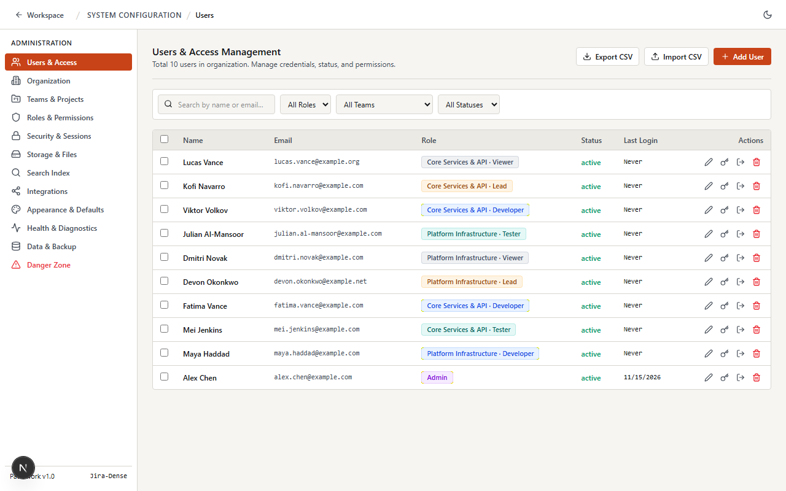
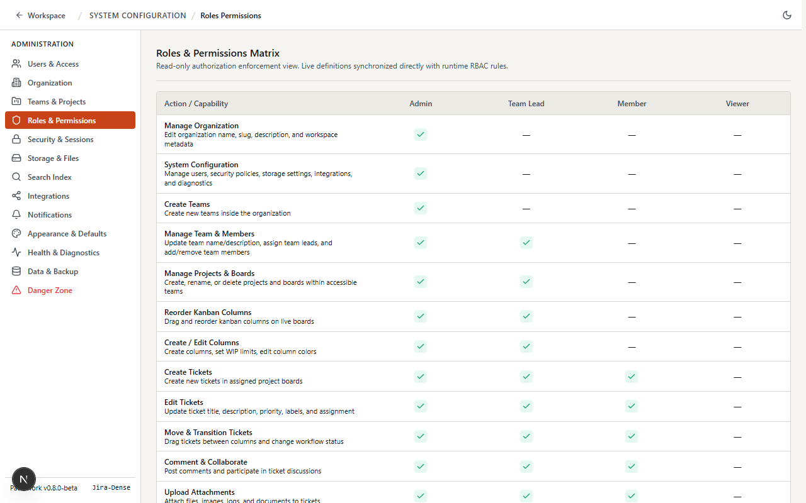

import { Aside } from "@astrojs/starlight/components";

This guide is for organization administrators (`admin` role). Non-admins receive `403 Forbidden` and are redirected from `/dashboard/system`.

{/* ROADMAP_ADMONITION_START:audit-log-viewer,backup-restore-ui,outbound-email-webhooks,cycle-time-wip-metrics */}
<Aside type="note" title="Planned for v1.0.0">
Not available in v0.8.1-beta: [Audit log viewer](/documentation/project/roadmap/#audit-log-viewer), [Backup and restore UI](/documentation/project/roadmap/#backup-restore-ui), [Cycle time and WIP metrics](/documentation/project/roadmap/#cycle-time-wip-metrics). See the [v1.0.0 Roadmap](/documentation/project/roadmap/).
</Aside>
{/* ROADMAP_ADMONITION_END */}

## All 12 Configuration Sections

1. **Users & Access** (`users`): Create, edit, deactivate, reset passwords, force sign-out, import/export CSV, and run bulk user actions.
2. **Organization** (`organization`): Edit organization name, URL slug, and description.
3. **Teams & Projects** (`teams-projects-boards`): Manage teams, team leads, team memberships, projects, and boards.
4. **Roles & Permissions** (`roles-permissions`): View the authoritative RBAC matrix enforced across the workspace.
5. **Security & Sessions** (`security`): Password complexity rules, session lifetime, idle timeout, and login rate-limit thresholds.
6. **Storage & Files** (`storage`): Max attachment size, allowed MIME types, allowed extensions, MinIO health check, and orphan file cleanup.
7. **Search Index** (`search`): Inspect FTS coverage and trigger a full PostgreSQL `tsvector` search index rebuild.
8. **Integrations** (`integrations`): Allowed GitHub/GitLab forge hosts, optional encrypted API tokens, and link metadata cache duration.
9. **Appearance & Defaults** (`appearance`): Default theme, date/time format, priority colors, default labels, and default board columns.
10. **Health & Diagnostics** (`health`): Live checks for PostgreSQL, MinIO bucket connectivity, migration status, and runtime diagnostics.
11. **Data & Backup** (`data-backup`): Export workspace data and view backup guidance.
12. **Danger Zone** (`danger-zone`): Irreversible administrative actions including archiving old tickets and purging deactivated accounts.

## Expected Result

Settings saved in System Configuration are validated against Zod schemas (`src/lib/settings.ts`), stored in `system_settings`, and applied immediately without restarting the server.

## Related Pages

- [User Management](/documentation/admin-guide/user-management/)
- [Sessions & Security Policy](/documentation/admin-guide/sessions-and-security-policy/)
- [Configuration & Settings Reference](/documentation/reference/configuration/)
