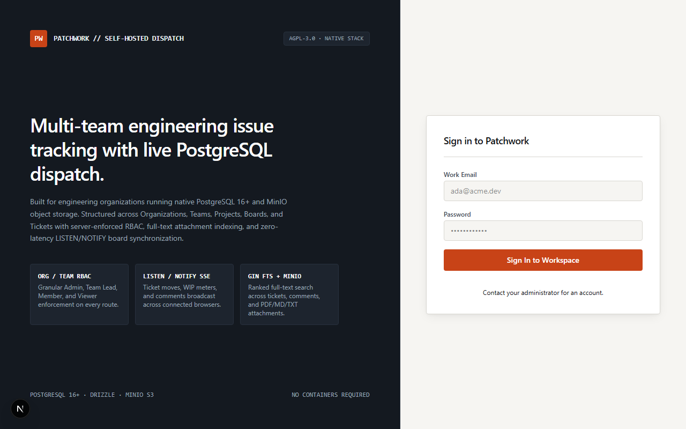

import { Tabs, TabItem, Aside } from "@astrojs/starlight/components";

Patchwork's default **Easy** install provisions PostgreSQL 18 and MinIO automatically inside your project folder—no Docker, no manual database setup, and no administrator privileges required.

## Prerequisites

- **Node.js 20+** and **git**:

<Tabs>
  <TabItem label="Windows (PowerShell)">
    ```powershell
    winget install OpenJS.NodeJS.LTS Git.Git
    ```
  </TabItem>
  <TabItem label="Linux (Ubuntu / Debian)">
    ```bash
    sudo apt update && sudo apt install -y nodejs npm git
    ```
  </TabItem>
</Tabs>

## Step 1: Clone and Install Dependencies

```bash
git clone https://github.com/Pratyush-Nirwan/patchwork.git
cd patchwork
npm ci
```

## Step 2: Run the Installer

```bash
npm run setup
```

Select **Easy (recommended)**. The installer checks disk space and ports, downloads and SHA-256 verifies the official MinIO binary into `./bin/`, initializes PostgreSQL 18 in `./data/postgres`, runs migrations, displays your one-time **Admin Setup Token**, and starts the supervisor (`npm run start`).

<Aside type="caution">
Save the Admin Setup Token immediately. It is displayed once and cannot be recovered. If lost before completing `/setup`, run Reset in `npm run setup`.
</Aside>

## Step 3: Open the URL and Complete Setup

1. Open the printed URL (by default `http://localhost:3000/setup`).
2. Enter your Admin Setup Token to unlock the [Setup Wizard](/documentation/getting-started/setup-wizard/).
3. Create your admin account, organization, teams, and boards, then sign in.



## Managing the Running Stack

- Check status: `npm run status`
- Stop cleanly: `npm run stop` (or `Ctrl+C` in foreground)
- Start again later: `npm run start`

## Related Pages

- [Installation](/documentation/getting-started/installation/)
- [Advanced Installation](/documentation/getting-started/advanced-installation/)
- [Setup Wizard](/documentation/getting-started/setup-wizard/)
