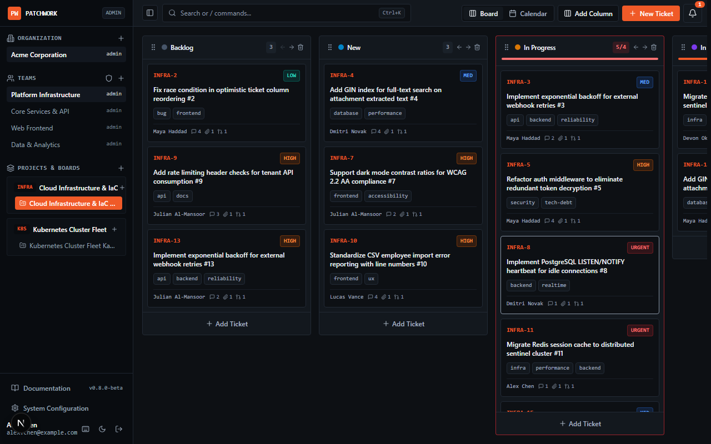

import { Badge } from "@astrojs/starlight/components";
import appMeta from "../../../data/generated/app-meta.json";
export const versionLabel = appMeta.displayVersion;

  

    <Badge text={`Release ${versionLabel}`} variant="note" />
    Pre-1.0 beta &mdash; back up PostgreSQL, <code>.env</code>, and MinIO before upgrading.
  

  <a class="pw-docs-status-link" href="/documentation/changelog/">Changelog &rarr;</a>

  

    <h3>Getting Started</h3>
    
Install natively on Windows or Linux with Node.js, PostgreSQL, and MinIO &mdash; no Docker required.

    <ul>
      <li><a href="/documentation/getting-started/quick-start/">Quick Start</a></li>
      <li><a href="/documentation/getting-started/installation/">Installation Guide</a></li>
      <li><a href="/documentation/getting-started/setup-wizard/">Setup Wizard</a></li>
    </ul>
  

  

    <h3>User Guide</h3>
    
Navigate boards, run slash commands with <code>Ctrl+K</code>, and collaborate with mentions and watchers.

    <ul>
      <li><a href="/documentation/user-guide/workspace-and-boards/">Workspace &amp; Boards</a></li>
      <li><a href="/documentation/user-guide/command-palette/">Command Bar</a></li>
      <li><a href="/documentation/user-guide/notifications-and-mentions/">Notifications &amp; Mentions</a></li>
    </ul>
  

  

    <h3>Admin &amp; Operations</h3>
    
Configure SMTP, outbound webhooks, user roles, HTTPS, and backup routines.

    <ul>
      <li><a href="/documentation/admin-guide/system-configuration/">System Configuration</a></li>
      <li><a href="/documentation/admin-guide/email-smtp/">Email &amp; SMTP</a></li>
      <li><a href="/documentation/operations/backups-and-upgrades/">Backups &amp; Upgrades</a></li>
    </ul>
  

  

    <h3>Reference &amp; Development</h3>
    
Inspect environment variables, database schema, RBAC permissions, and system architecture.

    <ul>
      <li><a href="/documentation/reference/configuration/">Configuration Reference</a></li>
      <li><a href="/documentation/reference/database-schema/">Database Schema</a></li>
      <li><a href="/documentation/development/architecture/">Architecture</a></li>
    </ul>
  

{/* ROADMAP_STRIP_START */}

  

    <strong>Coming in v1.0.0</strong>
    Ticketing and Workflow · Collaboration and Notifications · Views and Analytics · Git and Developer Integrations · Security, Audit, and Operations
  

  <a class="pw-cl-btn" href="/documentation/project/roadmap/">View v1.0.0 Roadmap &rarr;</a>

{/* ROADMAP_STRIP_END */}

## Workspace Preview

  

  

  

  

