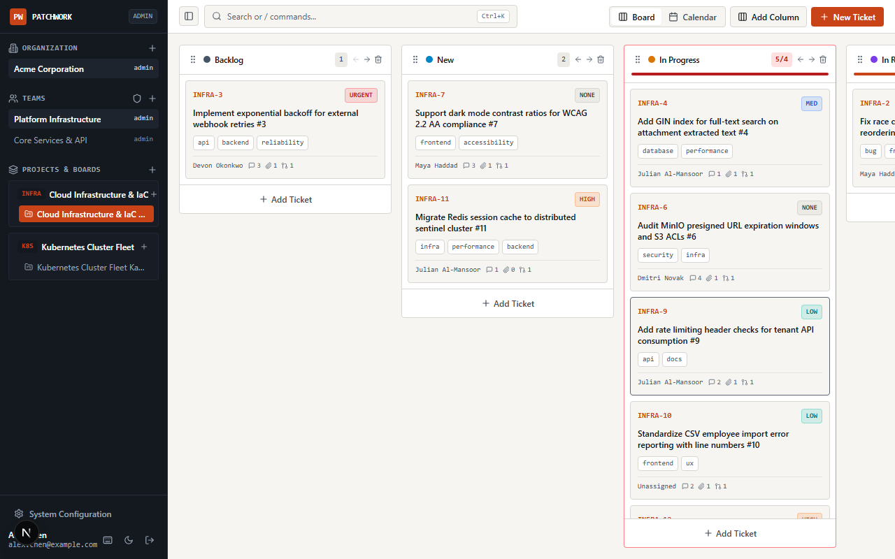

import { Aside, Badge, Card, CardGrid } from "@astrojs/starlight/components";
import appMeta from "../../../data/generated/app-meta.json";
export const versionLabel = appMeta.displayVersion;

  <Badge text={`Release ${versionLabel}`} variant="note" />

<Aside type="caution" title="Beta software">
  Patchwork {versionLabel} is pre-1.0 beta software. Features and data formats may change between releases. Always back up PostgreSQL, `.env`, and MinIO data before upgrading, and report issues on the project issue tracker.
</Aside>

{/* ROADMAP_STRIP_START */}
<Aside type="note" title="Coming in v1.0.0">
Planned areas: **Ticketing and Workflow** · **Collaboration and Notifications** · **Views and Analytics** · **Git and Developer Integrations** · **Security, Audit, and Operations**. See the full [v1.0.0 Roadmap](/documentation/project/roadmap/) for details. This roadmap describes planned work. Scope and timing may change.
</Aside>
{/* ROADMAP_STRIP_END */}

## Core Capabilities

<CardGrid stagger>
  <Card title="Multi-team hierarchy" icon="list-format">
    Organize work cleanly across Organization, Teams, Projects, Boards, Columns, and Tickets with server-enforced RBAC.
  </Card>
  <Card title="Real-time Kanban & Calendar" icon="rocket">
    Drag cards and reorder columns with WIP capacity gauges. PostgreSQL `LISTEN/NOTIFY` pushes live updates over SSE.
  </Card>
  <Card title="Spotlight Command Bar" icon="magnifier">
    Open with `Ctrl+K` (`Cmd+K` on macOS) to search tickets or run slash commands with inline ghost hints and autocomplete.
  </Card>
  <Card title="Native, zero-Docker stack" icon="setting">
    Runs directly on Node.js 20+, PostgreSQL 16+, and the official MinIO binary on Windows 10/11 and Linux.
  </Card>
</CardGrid>

## Workspace Preview

