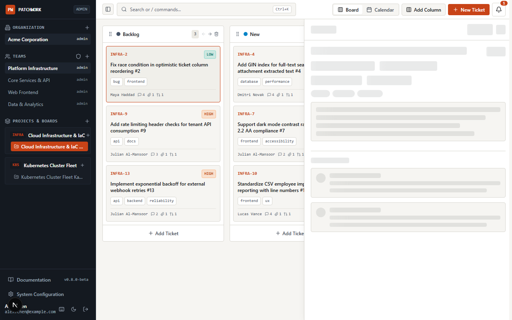

import { Aside } from "@astrojs/starlight/components";

This guide is for engineering team members (`admin`, `lead`, `member`; `viewer` has read-only access).

{/* ROADMAP_ADMONITION_START:in-app-notifications-mentions,ticket-watchers,ticket-templates-recurring,presence-typing-indicators */}
<Aside type="note" title="Planned for v1.0.0">
Not available in v0.8.0-beta: [Ticket templates and recurring tickets](/documentation/project/roadmap/#ticket-templates-recurring). See the [v1.0.0 Roadmap](/documentation/project/roadmap/).
</Aside>
{/* ROADMAP_ADMONITION_END */}

<Aside type="note">
**Role note**: Creating, editing, moving, and commenting on tickets requires `member` or higher. Teams using `developer` and `tester` sub-roles enforce column-transition rules unless overridden by a `lead` or `admin`.
</Aside>

## Creating & Editing Tickets

1. Click **+ New Ticket** in the top bar, press `c`, or run `/new <title>` in the Command Bar.
2. Click any ticket card to open the detail inspector panel:
   - **Title & Markdown Description**: Supports headings, lists, code blocks, and inline formatting.
   - **Priority**: `urgent`, `high`, `medium`, `low`, or `none`.
   - **Assignee**: Assign to yourself or a team member.
   - **Labels & Due Date**: Tag tickets and set target dates (shown in Calendar view).

## Moving Tickets & Workflow Rules

Drag ticket cards between columns or use `/move <ticket> <column>` in the Command Bar. Every move is recorded in the ticket's **Activity History**.

## Comments & Activity History

- Post Markdown comments at the bottom of the ticket panel (`ticket.comment`).
- Review chronological status changes, assignments, and attachment events in the activity feed.

## Expected Result

Ticket mutations update the board immediately for all connected viewers via PostgreSQL `LISTEN/NOTIFY` and SSE.

## Related Pages

- [Attachments & Links](/documentation/user-guide/attachments-and-links/)
- [Command Palette & Slash Commands](/documentation/user-guide/command-palette/)
